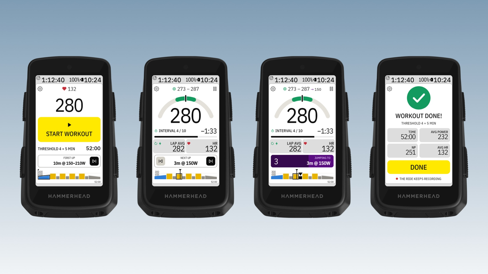

# BetterIntervals for Karoo 3

*Formerly Interval Screen. On the Karoo it is listed as **DDB BetterIntervals**, next to David's other apps.*

A full-page data field for the Hammerhead Karoo 3 that makes structured workouts easy to follow.
It loads your planned workouts from [intervals.icu](https://intervals.icu) and runs them itself, so
you can jump forward **and back** between intervals.

<picture>
  <source media="(prefers-color-scheme: dark)" srcset="docs/images/betterintervals-dark.jpg">
  
</picture>

- **Big 3-second power:** tap the watts to change how the target range shows: plain, coloured
  number, coloured background, both, or a **power gauge**. Blue is below the range, green in it,
  red above it.
- **Interval, time left and progress bar,** with lap average and target (tap Lap avg for Lap NP,
  tap Target for the range) and heart rate.
- **Next up with ⏮ / ⏭:** a jump starts a 5-second countdown with beeps, so you can get ready.
- **The whole workout as a chart** in zone colours with a "now" marker; tap it to zoom in.
- **Pause** stops the interval timer (for traffic, say) while the ride keeps recording. One lap per
  interval in your ride file, and short beeps before each interval ends.
- **Without a workout:** big watts, lap time, lap average and heart rate (tap HR for the lap's
  average), and the last lap.
- **The Karoo's own look:** its fonts, field sizes and colours. **Dark / Light / Auto** follows the
  Karoo or stays fixed.
- **Remote button actions:** next interval, previous interval, pause or resume the workout.

Values show `--` when a sensor isn't connected. There's a step-by-step
[guide with pictures](docs/guide/README.md) for every feature.

Developers: read `../CLAUDE.md` (the Karoo playbook) first.

## Install on your Karoo

1. On your phone, open the latest [release](../../releases/latest) and share the `.apk` download
   link to the **Hammerhead Companion** app. It installs the app on your paired Karoo.
   (With a computer: `adb install betterintervals.apk`.)
2. On the Karoo, open **DDB BetterIntervals** from the app list, tap the person icon and enter your
   intervals.icu API key (intervals.icu → Settings → Developer settings). Keep Athlete ID `0`.
3. Pick a workout from this week's list.
4. In a ride profile, add a page with one field and choose **DDB BetterIntervals → Workout screen**.
5. Optional: assign *Next interval*, *Previous interval* and *Pause or resume workout* to remote buttons.

Syncing uses the Karoo's Wi-Fi, or your phone through the Companion app. Your API key is stored
only on the Karoo.

Don't also start the same workout in Karoo's own workout player: this app marks a lap at every
interval change, which would move Karoo's player along too.

## Build it yourself

1. Install [Android Studio](https://developer.android.com/studio) and run its setup wizard
   (**Standard**), which installs the Android SDK.
2. Open this folder in Android Studio and run it on a Karoo connected over USB (developer mode and
   USB debugging on). Or from a terminal:
   ```bash
   ./gradlew :app:installDebug
   ```
   If Gradle can't find Java, use Android Studio's: on macOS
   `JAVA_HOME="/Applications/Android Studio.app/Contents/jbr/Contents/Home"`.

Debug builds (what Android Studio's Run button installs) show **demo data**: made-up power, heart
rate and laps that change every 3 seconds, around a 300 W target, so the screens can be checked
without riding. It lives in `app/src/debug/`; release builds use `app/src/release/`, which passes
real data straight through, so demo data never ships.

Build output goes to `build.nosync/` folders, which iCloud Drive skips, since a synced Documents
folder otherwise creates "file 2" copies that break the build.

Only install while no ride is recording: Karoo doesn't restart a field's view mid-ride, so the
screen freezes until the ride screen is reopened.

No GitHub token is needed. The Karoo SDK (karoo-ext 1.1.9, Apache 2.0) is included as source in
`karoo-ext/`.

## Publishing a release

Releases must always be signed with the **same key**, or Karoos with an older version can't update.

1. Create the key once (Android Studio → Build → Generate Signed App Bundle or APK → Create new),
   saved **outside** this folder (ours is `../keys/karoo_interval.jks`). Back it up. The key, the
   `applicationId` `com.daviddokakis.karoointerval` and the field IDs stay the same after the rename
   to BetterIntervals, so installed copies keep updating and ride pages keep the field.
2. Copy `keystore.properties.example` to `keystore.properties` and fill in the passwords. Both
   files are git-ignored.
3. Raise `versionCode` and `versionName` in `app/build.gradle.kts`.
4. Build and publish:
   ```bash
   ./gradlew :app:assembleRelease
   ./gradlew -q :app:releaseManifest -PreleaseNotes="What changed"
   cp app/build.nosync/outputs/apk/release/app-release.apk betterintervals.apk
   gh release create v0.1.0 betterintervals.apk app/build.nosync/manifest.json --title "v0.1.0" --notes "What changed"
   ```
   Always upload `manifest.json` with the APK, and don't mark the release as a pre-release:
   Karoos find both through GitHub's `releases/latest/download/…` links.

### Update notices

From 0.5.3, the app names `releases/latest/download/manifest.json` in its AndroidManifest
(`io.hammerhead.karooext.MANIFEST_URL`). With it, the Karoo's Settings › Apps › DDB BetterIntervals
page shows the release notes and an **UPDATE** button that installs `betterintervals.apk` on the
Karoo. The Karoo only reads it when that page is opened, so `UpdateCheck.kt` tells the rider: when
the Karoo starts and then once a day, never during a ride, it reads the manifest and puts one
"Update available" card per new version in Control Center › Notifications. Tapping the card
opens that Karoo page. Riders can turn it off in Settings › Update notices.

To test it, serve a fake manifest with a higher `latestVersionCode` from the Mac and point a
release-key build at it (the Karoo reaches the Mac through `adb reverse`):

```bash
./gradlew :app:assembleRelease -PmanifestUrl=http://localhost:8791/manifest.json
adb reverse tcp:8791 tcp:8791
adb install -r app/build.nosync/outputs/apk/release/app-release.apk
```

The card appears about a minute after the app starts (only when no ride is recording): a build
with a different manifest URL forgets the last check. After that it checks once a day. Never
publish a build made with `-PmanifestUrl`; install the real release afterwards (the test
manifest's UPDATE does that if its `latestApkUrl` is the real APK).

Without `keystore.properties`, release builds fall back to the debug key: fine for testing, but
don't publish those.

## Code map

| File | What it does |
| --- | --- |
| `IntervalExtension.kt` | Entry point Karoo binds to; remote button actions |
| `WorkoutSession.kt` | Workout engine: clock, steps, jump countdown, pause, lap average, sensor data |
| `IntervalDataType.kt` | The data field; redraws once a second, right away for countdown numbers |
| `ScreenRenderer.kt` | Builds the field (workout screen and free-ride screen) |
| `ChartRenderer.kt` | Draws the workout chart and the list thumbnails |
| `UpdateCheck.kt` | "Update available" card when a newer release is on GitHub; opens the Karoo's app page |
| `IntervalsIcu.kt`, `KarooHttp.kt` | intervals.icu client, requests through the Karoo's connection |
| `PlanStore.kt` | Selected workout, API key, synced week, saved progress (app-private storage) |
| `SetupActivity.kt`, `AccountActivity.kt` | Workouts page and Account page |
| `res/layout/field_interval.xml`, `field_free.xml` | Field layouts, sized for a Karoo 3 full page |

## Things learned on the device

- Karoo 3: Android 12 (API 32), 480×800 at 300 dpi; a full-page field is 478×721 px.
- A loaded route makes the field shorter without telling the app, so the watts size themselves to
  the space they get.
- Taps in the top ~20 px of a field don't reach the app (Karoo's swipe-down area).
- Field layouts may only use RemoteViews widgets (no plain `View`), and update at most once a second.

## Licence

MIT, see `LICENSE`. The included Karoo SDK in `karoo-ext/` is Apache 2.0, see `karoo-ext/LICENSE`.
