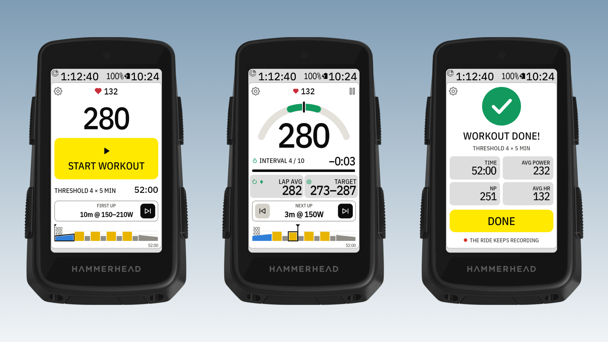
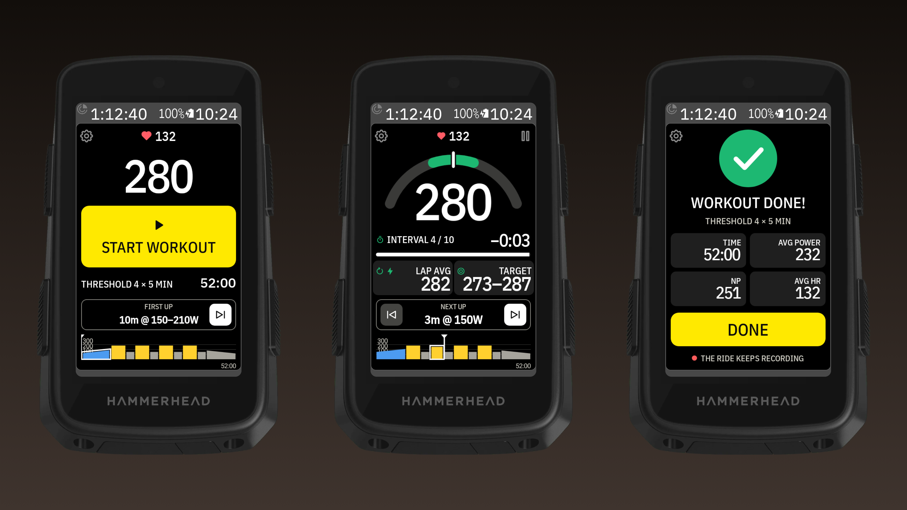
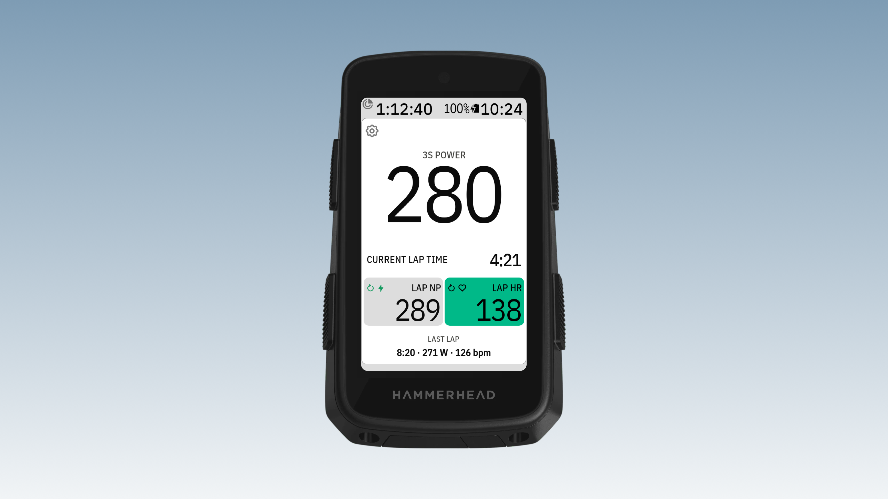
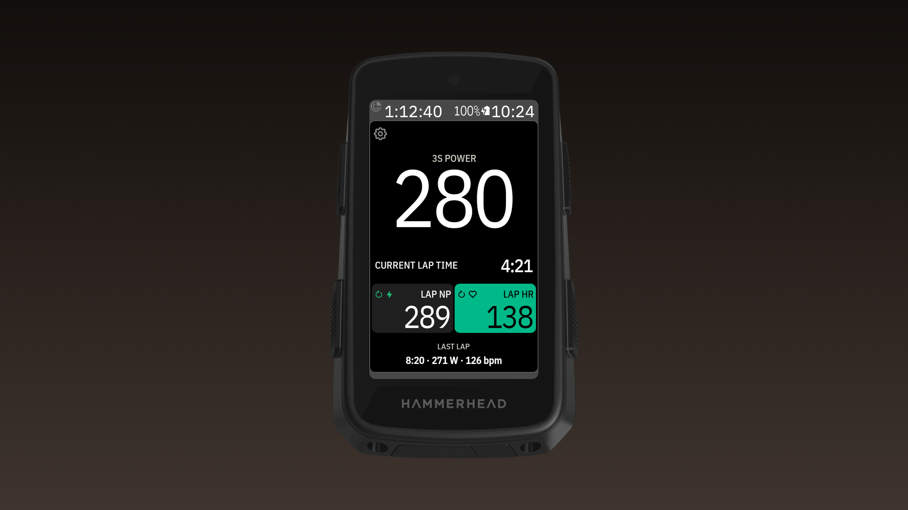
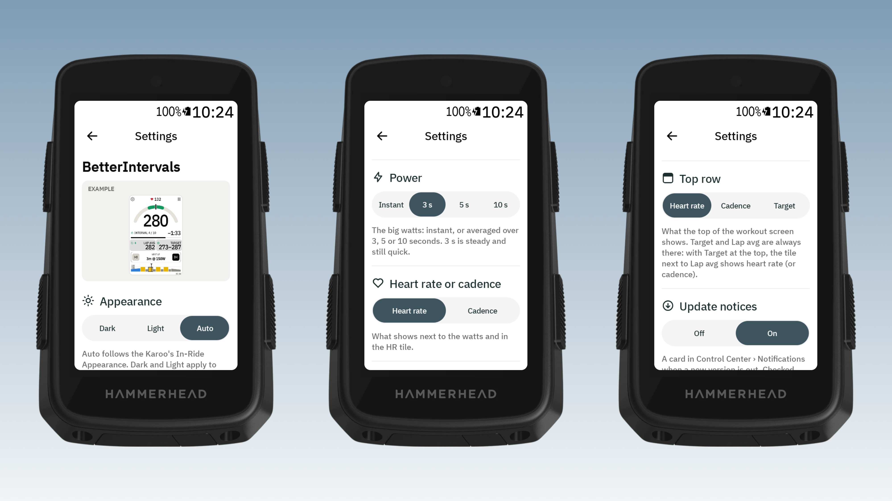

# BetterIntervals for Karoo 3

*Formerly Interval Screen. On the Karoo it is listed as **DDB BetterIntervals**, next to the other DDB apps.*

A full-page data field for the Hammerhead Karoo 3 that makes structured workouts easy to follow.
It loads your planned workouts from [intervals.icu](https://intervals.icu) and runs them itself, so
you can jump forward **and back** between intervals.

- **Before, during and after:** a workout waits for **START WORKOUT** (pick where to start with
  ⏮ / ⏭, then a 5-second countdown), runs interval by interval with beeps before each change,
  and ends on a **Workout complete** screen with its time, average power, NP and heart rate.
- **Big power** (instant or 3 / 5 / 10 s): starts on the **power gauge**; tap the watts for a plain,
  coloured number, coloured background or both. Blue is below the range, green in it, red above it.
- **Interval, time left and progress bar,** with lap average and target (tap Lap avg for Lap NP,
  tap Target for the range) and heart rate. **Settings › Top row** puts heart rate, cadence or the
  target at the top.
- **Next up with ⏮ / ⏭:** a jump starts a 5-second countdown with beeps, so you can get ready.
- **The whole workout as a chart** in zone colours with a "now" marker; tap it to zoom in.
- **Pause** stops the interval timer (for traffic, say) while the ride keeps recording. One lap per
  interval in your ride file, and short beeps before each interval ends.
- **Without a workout:** big watts, the current lap time, and two tiles you tap through: LAP AVG,
  LAP NP, RIDE AVG and HR, LAP HR, RIDE HR (heart rate in the Karoo's zone colours), plus the
  last lap.
- **The Karoo's own look:** its fonts, field sizes, icons and colours. **Dark / Light / Auto** follows the
  Karoo or stays fixed.
- **Remote button actions:** next interval, previous interval, pause or resume the workout.

### Without a workout

Big power and the current lap, and two tiles you tap through: the lap's average, the lap's NP and the
whole ride's average, and heart rate now, for the lap and for the ride.

### Settings

Each change shows straight away in the example at the top.

Values show `--` when a sensor isn't connected. There's a step-by-step
[guide with pictures](docs/guide/README.md) for every feature.

Building it yourself or making a release: see [docs/DEVELOPING.md](docs/DEVELOPING.md).

## Install on your Karoo

1. On your phone, open the latest [release](../../releases/latest) and share the `.apk` download
   link to the **Hammerhead Companion** app. It installs the app on your paired Karoo.
   (With a computer: `adb install betterintervals.apk`.)
2. On the Karoo, open **DDB BetterIntervals** from the app list, tap the person icon and enter your
   intervals.icu API key (intervals.icu → Settings → Developer settings). Keep Athlete ID `0`.
3. Pick a workout from this week's list.
4. In a ride profile, add a page with one field and choose **DDB BetterIntervals → Workout screen**.
5. Optional: assign *Next interval*, *Previous interval* and *Pause or resume workout* to remote buttons.

Syncing uses the Karoo's Wi-Fi, or your phone through the Companion app. Your API key is stored
only on the Karoo.

Don't also start the same workout in Karoo's own workout player: this app marks a lap at every
interval change, which would move Karoo's player along too.

## Licence

MIT, see `LICENSE`. The included Karoo SDK in `karoo-ext/` is Apache 2.0, see `karoo-ext/LICENSE`.
