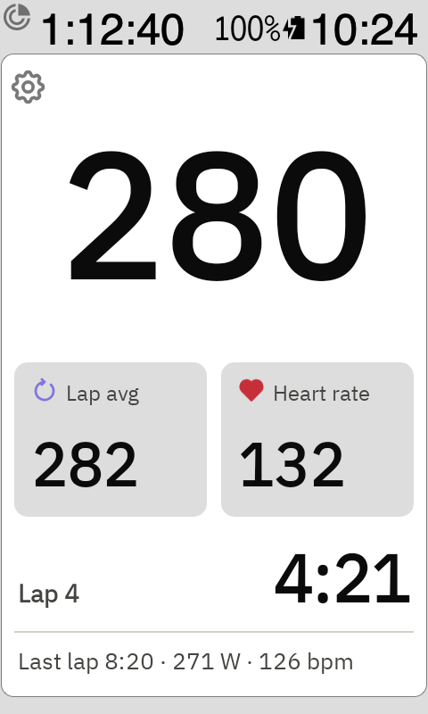
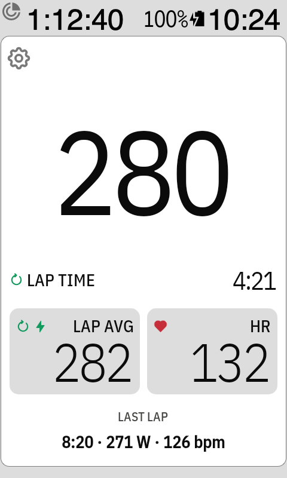

# Riding without a workout

With no workout picked, BetterIntervals shows a free-ride screen instead.

- **Big number**: 3-second power.
- **Lap avg** tile: average power of the Karoo's current lap. Tap it to switch to **Lap NP**, like
  on the [workout screen](tiles.md).
- **Heart rate** tile: takes the colour of your heart rate zone (zones from your Karoo rider
  profile), in the same colours as the Karoo's own HR field with Zone Color on.
- **Lap number and lap time**, with the last lap's time and average below.

Tap ⚙ to open the [Workouts page](workouts-and-account.md) and pick a workout.

With [Karoo style](settings.md) on, the screen takes the Karoo's own look: the watts first, a
**LAP TIME** row, Lap avg and HR as full-size Karoo data fields (the HR field in its zone colour),
and the last lap at the bottom.

Tap the heart rate tile to switch between your current heart rate and the lap's average
(**Lap HR**); the app remembers your choice. The last lap shows its time, average watts and
average heart rate.

