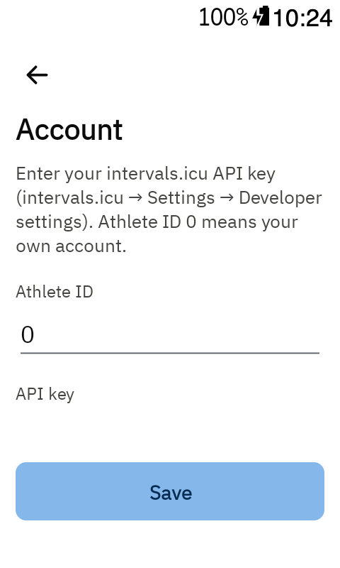

# Getting started

Interval Screen loads your planned workouts from [intervals.icu](https://intervals.icu) and runs
them itself on the Karoo, so you can move forward **and back** between intervals.

## 1. Install the app

On your phone, open the latest [release](https://github.com/Dubadai/karoo-interval/releases/latest)
and share the `interval-screen.apk` download link to the **Hammerhead Companion** app. It installs
the app on your paired Karoo.

Updating works the same way, and keeps your settings and API key: see [Updating the app](updating.md).

## 2. Connect intervals.icu

1. On the Karoo, open **Interval Screen** from the app list.
2. Tap ⚙ to open **Settings**, then **intervals.icu account**.
3. Enter your intervals.icu API key. You find it on intervals.icu under **Settings → Developer
   settings**.
4. Leave **Athlete ID** at `0`, which means your own account, and tap **Save**.

Your API key is stored only on the Karoo.

## 3. Pick a workout

Back on the **Workouts** page, tap **Sync** and pick a workout from this week's list. The app
goes straight back to the ride screen. See [Workouts and Account](workouts-and-account.md) for more.

## 4. Add the screen to a ride profile

1. In a Karoo ride profile, add a page with **one** data field.
2. Choose **Interval Screen → Interval screen** for that field.

The screen fills the whole page. With a route loaded the Karoo makes the field a bit shorter, and
the watts shrink to fit.

## 5. Optional: remote buttons

In the Karoo's controller settings you can assign these to remote buttons:

- **Next interval** and **Previous interval**: the same as tapping ⏭ / ⏮ on the screen. See
  [Jumping between intervals](jumping.md). A choice made with a remote confirms itself after
  5 seconds, so you don't need to touch the screen.
- **Pause or resume workout**: see [Pausing the workout](pausing.md).

## Good to know

- Don't also start the same workout in the Karoo's own workout player. Interval Screen marks a
  lap at every interval change, which would move the Karoo's player along too.
- Syncing uses the Karoo's Wi-Fi, or your phone through the Companion app.
