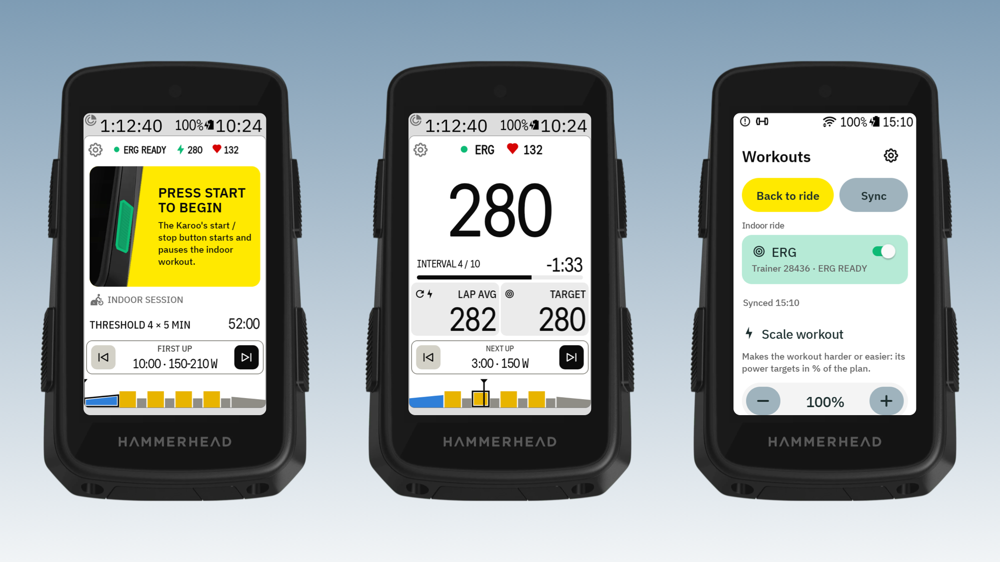
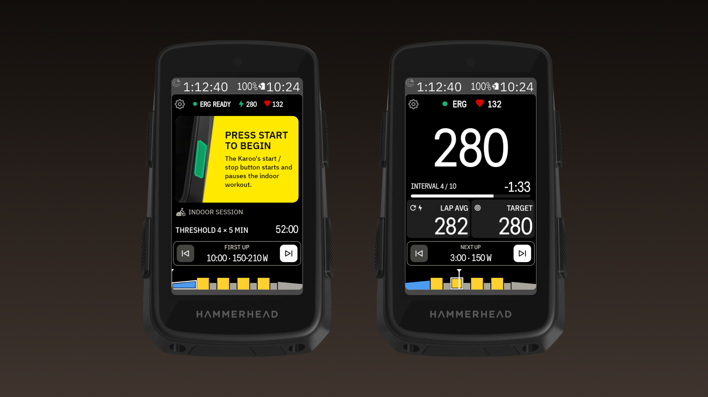

# Indoor with a trainer (ERG)

On an **indoor ride profile**, BetterIntervals controls your smart trainer: the trainer holds each
interval's watts (ERG), so you just pedal. It talks to the trainer over Bluetooth (FTMS, the
standard most smart trainers support, or FE-C over Bluetooth for Tacx trainers without FTMS) or over
ANT+ FE-C ([below](#over-ant-original-tacx-neo-t2800)). Tested on a Wahoo KICKR CORE over Bluetooth
and an original Tacx NEO (T2800) over ANT+.

## Set it up once

1. Pair the trainer on the Karoo as usual (**Sensors**). BetterIntervals uses the trainer the Karoo
   has paired, over ANT+ or Bluetooth.
2. On the Karoo, set the trainer's card to **Read-Only**, so only BetterIntervals sets ERG.
3. In BetterIntervals **Settings › Trainer (indoors)**, turn on **ERG on indoor rides** and allow
   Bluetooth when asked. Settings then shows the trainer it found.
4. Use a ride profile marked **indoor** on the Karoo, with the BetterIntervals page in it.

**When paused** sets what the trainer holds while the workout is paused or between workouts:
40, 50 or 60 % of your FTP.

## Over ANT+ (original Tacx NEO, T2800)

**Settings › Trainer (indoors) › Connection** picks how the app reaches the trainer:

- **Bluetooth** (default, everything above): the Karoo stays on the trainer over ANT+ (trainer
  card in Read-Only) and the app controls it on its Bluetooth side. The trainer's Bluetooth has to
  be free for the app: don't also pair it on the Karoo over Bluetooth (the original NEO takes one
  Bluetooth connection).
- **ANT+**: the app connects to the trainer over ANT+ itself. For trainers it can't reach over
  Bluetooth. The Karoo can't share a trainer's ANT+ connection with an app, so the Karoo's own
  ANT+ trainer has to be off on that profile, and the app adds the trainer to the Karoo's sensors
  instead.

Setting up ANT+:

1. **Settings › Trainer › Connection › ANT+.**
2. **Karoo Sensors › Add sensor:** BetterIntervals lists the trainer, e.g. *Tacx NEO trainer
   (BetterIntervals)* (the ANT+ trainers paired on the Karoo, and the first one it hears nearby).
   Add it. The Karoo now gets power, cadence and speed from the app's connection: the ride file
   records the trainer the app controls.
3. If the Karoo has its own ANT+ pairing of the trainer, switch it **off for the indoor profile**
   (Sensors › the trainer › Enabled on › untick the profile). Settings says so when it's in the way.

Settings then shows the trainer with *ANT+ from this app*. No Bluetooth permission is needed.

**Settings checks the setup for you.** Under *Connection*, each step shows green when it's right
and amber with the fix when it isn't: the trainer on (or off) for the profile, the trainer's
Bluetooth not taken by a Karoo sensor, the BetterIntervals sensor on or off as the connection
needs, and something recording power. *Open Karoo Sensors* takes you straight there. Before an
indoor ride the start screen shows the first problem in amber on the INDOOR SESSION line (for
example *ERG: Karoo ANT+ is on*); the gear opens Settings.
Tip: copy your indoor profile and do this on the copy, so the original keeps the Karoo's own
trainer control.

## Starting

Pick a workout. Before the ride starts, the top row shows **● ERG READY** once the trainer is
connected, with your watts and heart rate next to it, and the yellow box shows the Karoo's own
start button flashing green.

**Press the Karoo's start button**: the ride starts recording and the workout starts with its
5-second countdown. Tapping the yellow box does the same.

Indoors the Karoo's start / stop button is the only pause: there's no separate workout pause, since
the trainer sets the watts anyway.

## During the workout

The trainer holds the target of each interval (the workout screen keeps ERG off it: its state is on
the Workouts page). Jumping with
⏭ / ⏮ moves the trainer to the new interval's watts. The watts for workouts in % of FTP come from
intervals.icu, using the FTP you set there.

**ERG on or off for this ride:** open the **Workouts** page (⚙). The **Indoor ride** card has an
**ERG** switch. Off: the trainer is free (*Free ride*) and you ride the targets yourself, with the
gauge back. On again: the trainer picks up the current interval.

## When the workout is done

The ride pauses and the trainer is handed back. To cool down, resume the ride on the Karoo and set
the trainer's resistance yourself. Starting another workout mid-ride: the trainer holds the
*When paused* watts while you pick one.

## Match PM

If your bike has a power meter, **Settings › Trainer (indoors) › Match PM** makes the power meter
show the target instead of the trainer's own reading. It keeps comparing the two and corrects the
trainer live, separately for each 50 W band and as the trainer warms up, never more than 10 %.
After a ride, Settings shows what it found. If the Karoo's power comes from the trainer itself,
there's nothing to match and Settings says so.

## Trainer on, outdoor profile

If you start pedalling on the trainer with an outdoor profile and a workout loaded, an orange note
under START WORKOUT says **Trainer connected: pick an indoor profile to use ERG.** ERG only runs
on indoor profiles, so a trainer you forgot to switch off never interferes with an outdoor ride.
