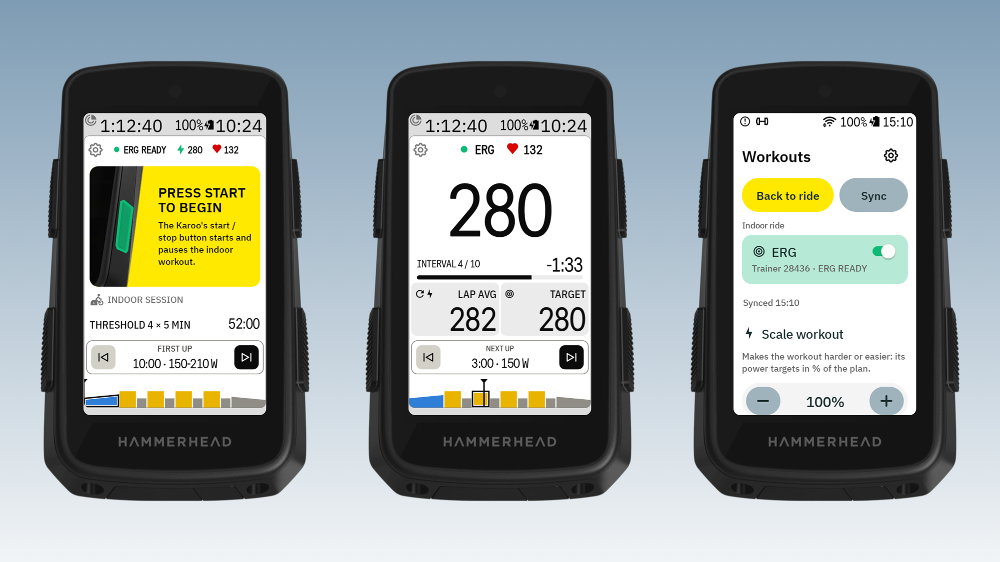
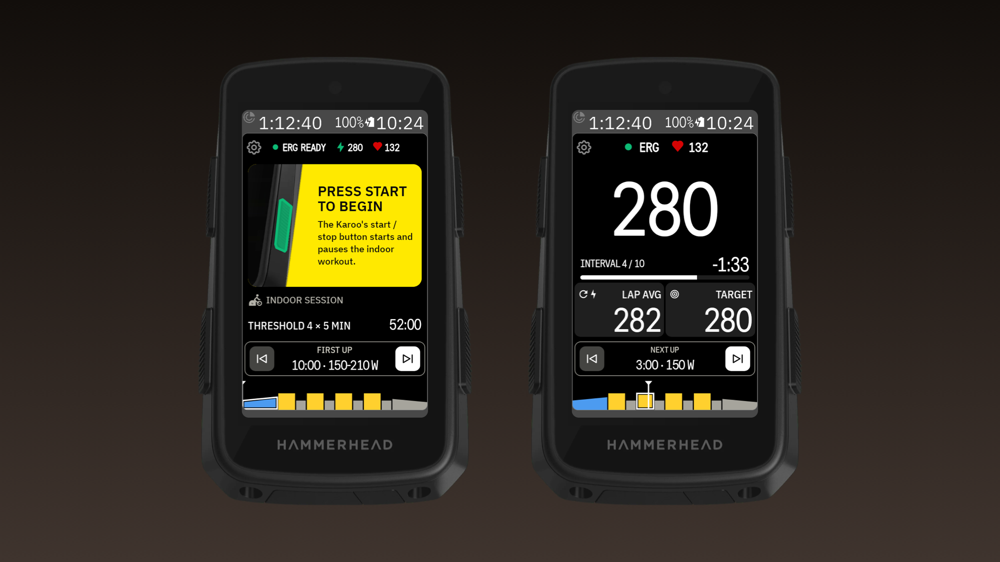

# Indoor with a trainer (ERG)

On an **indoor ride profile**, BetterIntervals controls your smart trainer: the trainer holds each
interval's watts (ERG), so you just pedal. It talks to the trainer over Bluetooth (FTMS), the
standard most smart trainers support. Tested on a Wahoo KICKR CORE.

## Set it up once

1. Pair the trainer on the Karoo as usual (**Sensors**). BetterIntervals uses the trainer the Karoo
   has paired, over ANT+ or Bluetooth.
2. On the Karoo, set the trainer's card to **Read-Only**, so only BetterIntervals sets ERG.
3. In BetterIntervals **Settings › Trainer (indoors)**, turn on **ERG on indoor rides** and allow
   Bluetooth when asked. Settings then shows the trainer it found.
4. Use a ride profile marked **indoor** on the Karoo, with the BetterIntervals page in it.

**When paused** sets what the trainer holds while the workout is paused or between workouts:
40, 50 or 60 % of your FTP.

## Starting

Pick a workout. Before the ride starts, the top row shows **● ERG READY** once the trainer is
connected, with your watts and heart rate next to it, and the yellow box shows the Karoo's own
start button flashing green.

**Press the Karoo's start button**: the ride starts recording and the workout starts with its
5-second countdown. Tapping the yellow box does the same.

Indoors the Karoo's start / stop button is the only pause: there's no separate workout pause, since
the trainer sets the watts anyway.

## During the workout

The trainer holds the target of each interval, and the top row shows **● ERG**. Jumping with
⏭ / ⏮ moves the trainer to the new interval's watts. The watts for workouts in % of FTP come from
intervals.icu, using the FTP you set there.

**ERG on or off for this ride:** open the **Workouts** page (⚙). The **Indoor ride** card has an
**ERG** switch. Off: the trainer is free (*Free ride*) and you ride the targets yourself, with the
gauge back. On again: the trainer picks up the current interval.

## When the workout is done

The ride pauses and the trainer is handed back. To cool down, resume the ride on the Karoo and set
the trainer's resistance yourself. Starting another workout mid-ride: the trainer holds the
*When paused* watts while you pick one.

## Match PM

If your bike has a power meter, **Settings › Trainer (indoors) › Match PM** makes the power meter
show the target instead of the trainer's own reading. It keeps comparing the two and corrects the
trainer live, separately for each 50 W band and as the trainer warms up, never more than 10 %.
After a ride, Settings shows what it found. If the Karoo's power comes from the trainer itself,
there's nothing to match and Settings says so.

## Trainer on, outdoor profile

If you start pedalling on the trainer with an outdoor profile and a workout loaded, an orange note
under START WORKOUT says **Trainer connected: pick an indoor profile to use ERG.** ERG only runs
on indoor profiles, so a trainer you forgot to switch off never interferes with an outdoor ride.
