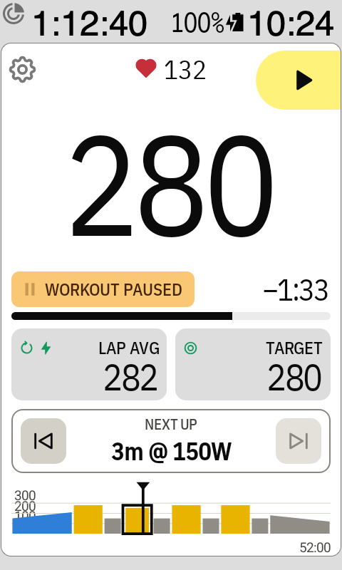
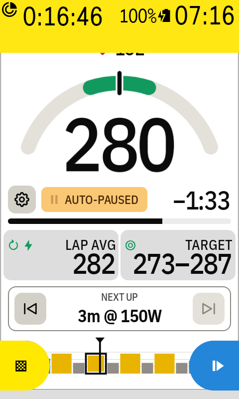

# Pausing the workout

Stopped at a traffic light or a café? Pause the workout so the interval doesn't run out.

## Pause and resume

1. Tap ⏸ in the top right corner (or use the remote button **Pause or resume workout**).
2. A yellow **Workout paused** box replaces the interval number. Its icon blinks.
3. ⏸ turns into a large Karoo-yellow ▶ button. Tap it to
   carry on where you stopped.
4. The ⏭ button turns grey and can't be tapped, so the play button is the one to press.

Pausing stops only the interval timer. **The ride keeps recording**, and the lap average keeps
counting.

## When the Karoo pauses the ride

If the Karoo pauses the ride (you paused it, or auto-pause did), the box says **Paused** or
**Auto-paused**. There's no resume button then: the workout carries on when the ride does. ⏭ is
grey here too.

The Karoo's yellow paused bar covers the top of the screen, so the ⚙ comes down next to the box.
Tap it to change the workout at the roadside, for example to [scale it](workouts-and-account.md#scale-workout).
Pausing only the workout while you keep riding leaves the ⚙ at the top.

