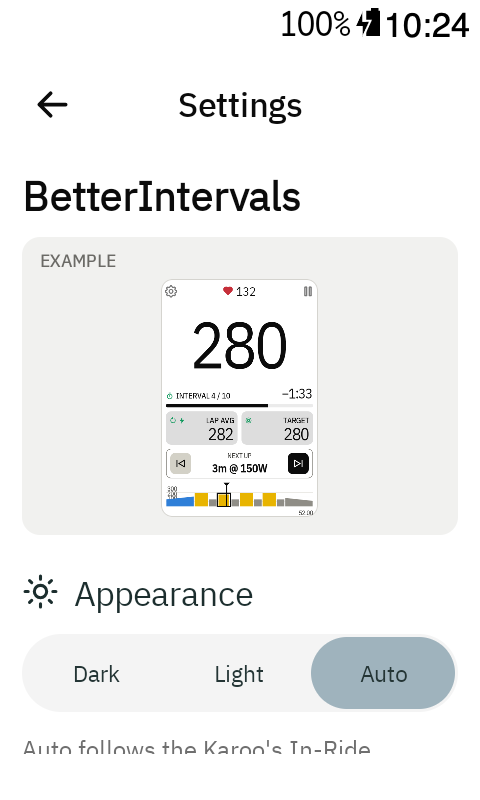
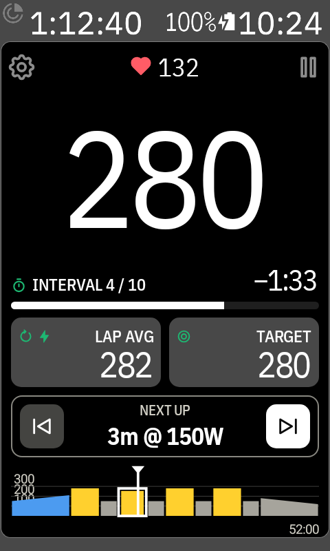
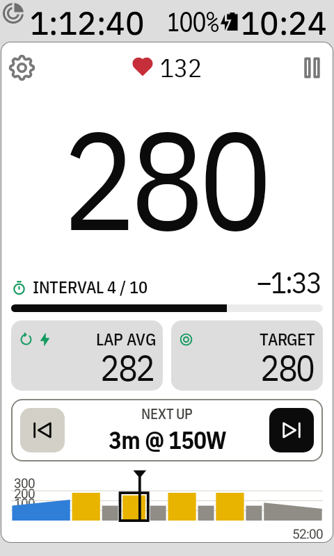
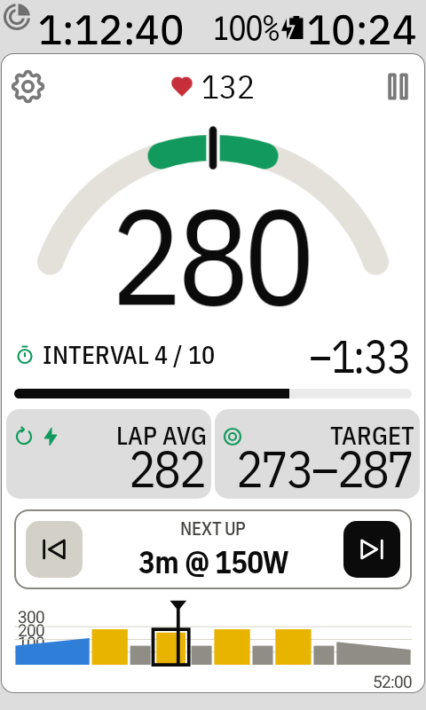
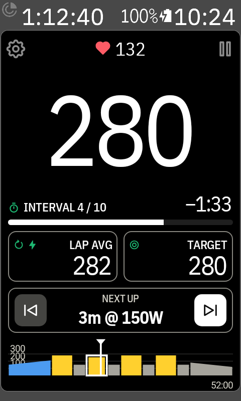
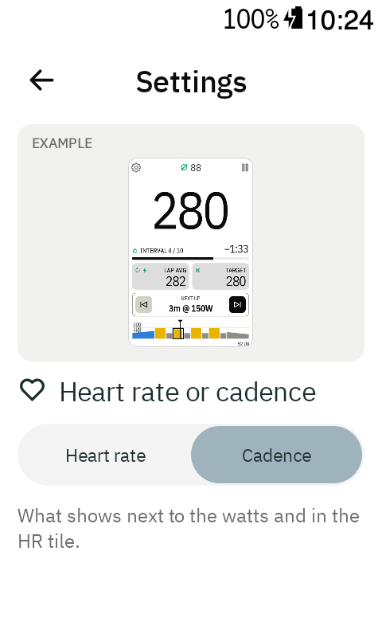
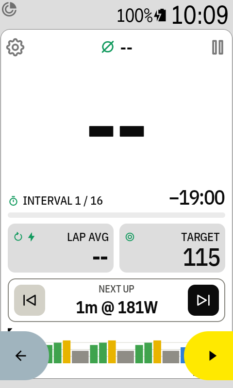
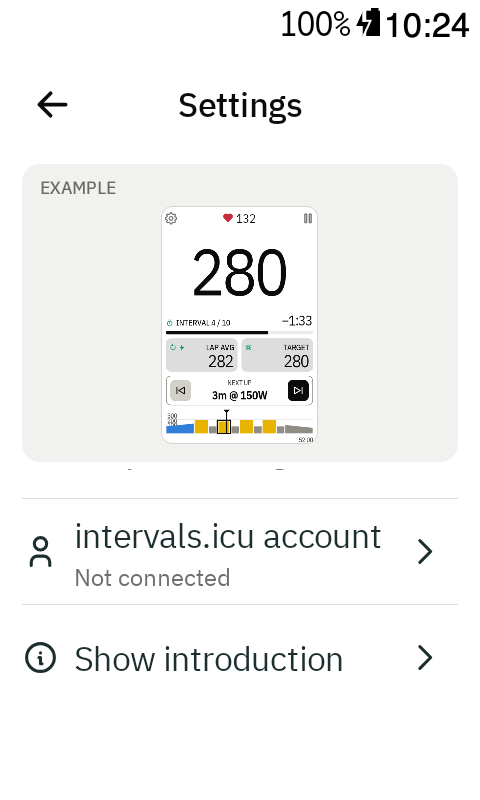

# Settings

Open the **Workouts** page (⚙ on the ride screen), then tap ⚙ in its top right corner.

## Appearance

**Dark / Light / Auto**, like the Karoo's own *In-Ride Appearance*.

- **Auto** (default): follows the Karoo's In-Ride Appearance.
- **Dark** or **Light**: the workout screen and the app's pages always use that mode, whatever
  the Karoo is set to. The Karoo's own top bar keeps its colours.

## The Karoo's own look

BetterIntervals always looks like the Karoo's own data pages (there's no setting for it):

- Karoo's fonts: condensed uppercase labels, and numbers in the same font as Karoo's fields.
- Everything under the watts is one compact block that looks the same on every screen, so the
  watts are always the biggest thing: Lap avg and Target (or HR on the gauge) with small green
  icons, which turn black on the coloured background (white in dark mode).
- All numbers share one weight; the watts are simply the biggest.
- The resume button is Karoo yellow. ⏭ is black (white in dark mode), so the Karoo's own yellow
  buttons and route pill stand out.

 

## Tiles

**Tonal / Outline**: how the Lap avg, Target and Heart rate tiles look.

- **Tonal** (default): a grey fill. With *Data field boundaries* on in the Karoo's settings, it's
  the same grey as the Karoo's page between fields.
- **Outline**: no fill, just a thin border like the Next up box.

 

## Power

**Instant / 3 s / 5 s / 10 s**: how the big watts are smoothed. Instant jumps with every pedal
stroke; 3 s (default) is steady and still quick; 5 s and 10 s are calmer for long, even efforts.

## Heart rate or cadence

**Heart rate / Cadence**: what shows in the heart rate spots: next to the watts at the top, in the
HR tile on the gauge screen, and in the free-ride HR tile (tap it for the lap's and the ride's average). With
**Cadence**, a cadence icon replaces the heart, the free-ride tile has no heart-rate zone colour,
and the last lap shows rpm instead of bpm.

With Cadence picked, a **Cadence** row appears: **Instant** (default, like the Karoo's own Cadence
field), **3 s**, **5 s** or **10 s**.

 

## Top row

**Heart rate / Cadence / Target**: what the top of the workout screen shows. The target and Lap
avg are always on the screen: whatever isn't at the top goes in the tile next to Lap avg. With
**Target** at the top, that tile shows heart rate (or cadence, if Heart rate or cadence says so).
Until you pick one, heart rate (or cadence) is at the top on every style, the gauge too.

All settings apply right away, also during a ride.

## Update notices

On (the default): a card in the Karoo's Notifications when a new version is out, checked once a
day and never during a ride. See [Updating the app](updating.md).

## intervals.icu account

Opens the [Account page](workouts-and-account.md#account) with your API key and athlete ID.

## Show introduction

Shows the four introduction pages again (connect, look, adding the screen to a ride profile,
tapping the watts). **Done** on the last page brings you back here.

