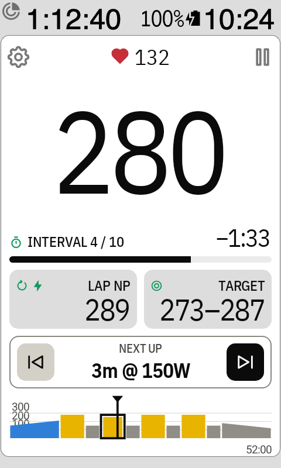
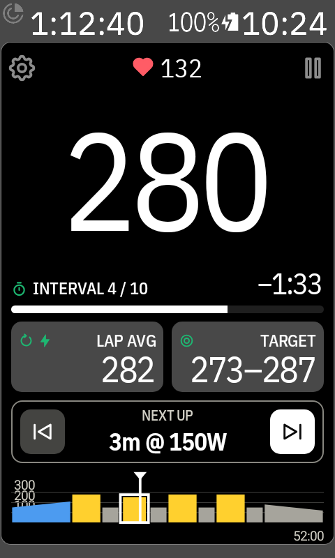

# The two tiles

The two tiles under the progress bar each show what you switch on in
[Settings › Workout screen](settings.md#workout-screen): **Left tile** and **Right tile**. By default
the left one shows **Lap avg** and the right one **Cadence**.

Each tile can show **Lap avg**, **Lap NP**, **Ride avg**, **Target**, **Heart rate**, **Cadence**,
**Calories** and **Speed**. With two or more switched on, tap the tile to go to the next one; its
icon and name say which one it shows, as on the Karoo's own fields. The Karoo remembers where you were between rides.
Switch everything off on a tile to leave it out: the other tile gets the whole width, and with
both off the watts get the room.

## Lap avg, Lap NP, Ride avg

- **Lap avg**: your average power in this interval.
- **Lap NP**: your normalised power in this interval. It weighs hard surges more than an average
  does, so it shows better how tough an uneven interval really was. It needs 30 seconds of riding,
  so it shows `--` at the start of each interval.
- **Ride avg**: your average power for the whole ride.

On a [heart-rate interval](workout-screen.md#heart-rate-targets), Lap avg and Lap NP show the lap's
average heart rate.

## Target ↔ Target range

When **Target** is the only thing on a tile, a tap switches between:

- **Target**: the watts for this interval, for example `300`.
- **Target range**: the range you should stay in, for example `293–308`. It's the same range the
  [watts colours](watts-colours.md) use. On ramps it moves with the target.

 
