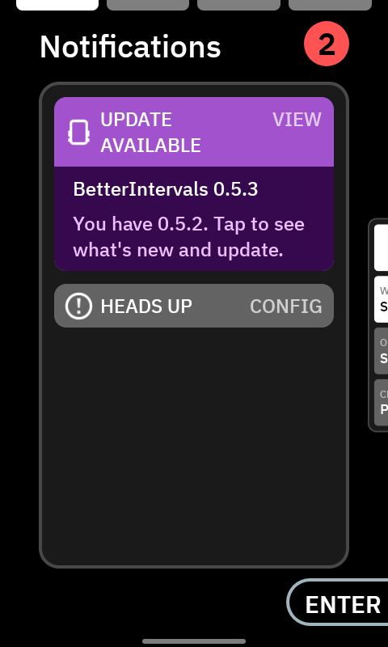

# Updating the app

New versions are published on the [Releases page](https://github.com/Dubadai/karoo-betterintervals/releases/latest).
Updating keeps your settings, your intervals.icu API key and the workout you picked.

## On the Karoo (from 0.5.3)

When a new version is out, an **Update available** card appears in the Karoo's Control Center
(swipe down from the top, then to **Notifications**). BetterIntervals checks once a day, and never
during a ride.

1. Tap the card. The Karoo opens its own page for DDB BetterIntervals, with what's new.
2. Tap **UPDATE**. The Karoo downloads and installs it (Wi-Fi or your phone's connection).

You can also go there yourself: Settings › Apps › DDB BetterIntervals. Don't want the cards?
⚙ on the Workouts page → **Settings** → **Update notices** → Off.

## With the Companion app

1. Make sure your Karoo is on, paired with the **Hammerhead Companion** app, and not recording a
   ride.
2. On your phone, open the [latest release](https://github.com/Dubadai/karoo-betterintervals/releases/latest).
3. Under **Assets**, long-press the `.apk` file and share the link to the **Hammerhead
   Companion** app.
4. The Karoo downloads and installs the update. BetterIntervals stays on your ride profile.

That's it: the next ride uses the new version.

## If the update won't install

The Karoo refuses an update that's signed differently from the version on it. That only happens
if you have a test build installed. Uninstall BetterIntervals on the Karoo, install the release as
above, then enter your API key again (⚙ on the Workouts page → **Settings** → **intervals.icu
account**).
