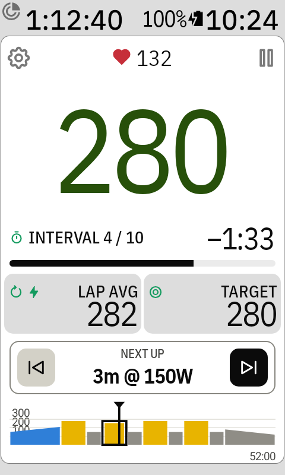
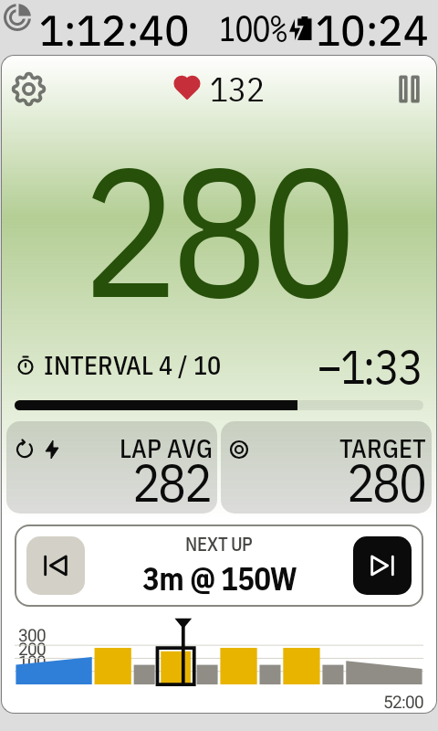
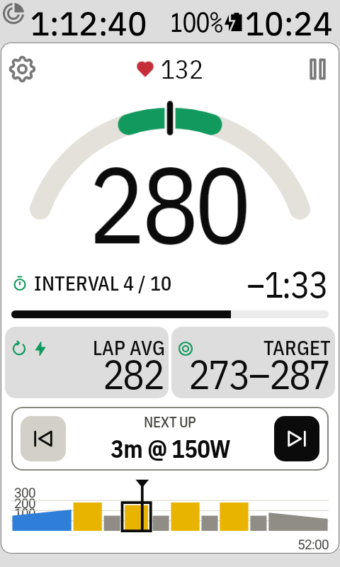

# Watts colours and the power gauge

The colours tell you at a glance whether you're on target:

- **Blue**: below the target range
- **Green**: in the range
- **Red**: above the range

The range is ±12% around the target (198 W: 174–222 W), so the normal ups and downs of riding
stay in it. An interval written as a range in intervals.icu uses that range as it is (148–191 W).
Heart-rate intervals use their own range from intervals.icu, or ±3%. The colours follow the big
watts (Settings › Power, 5 s by default).

## Choose how the colours show

Tap the big watts number to go through five styles:

1. **Plain**: no colour
2. **Coloured number**
3. **Coloured background**: a soft tint behind the watts
4. **Both**
5. **Power gauge**: see below

The power gauge is where you start. The Karoo remembers your choice between rides.

 

With a coloured background, the tiles, progress bar and corner icons are see-through, so they
take on the tint too.

There's no colour while the workout is paused, after it ends, or without a power meter or target.

## Power gauge

The fifth style turns the watts into a gauge: a grey arc with the target range in green, and a
needle at the same watts as the number (smoothed as in Settings › Power, 5 s by default). The target range moves to the top of the screen, and the right tile
shows your heart rate instead of the target. The interval time and the tiles stay where they are.

The arc reaches past the range on both sides (at least ±10% of the target, and at least twice the
range), so the green part is at most half the arc. Past either end, the needle stops at the
edge. Tap the watts again to go back to plain.

With a route loaded the screen is shorter, so the arc gets flatter and wider instead of shrinking,
and the watts stay big.
