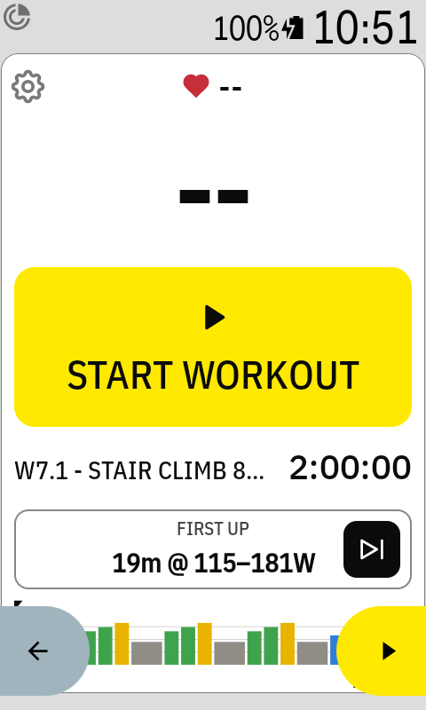
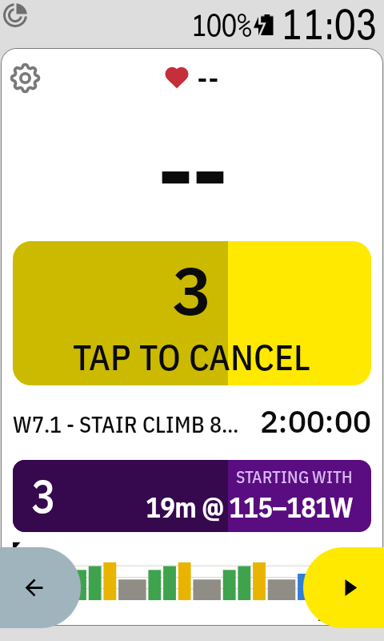
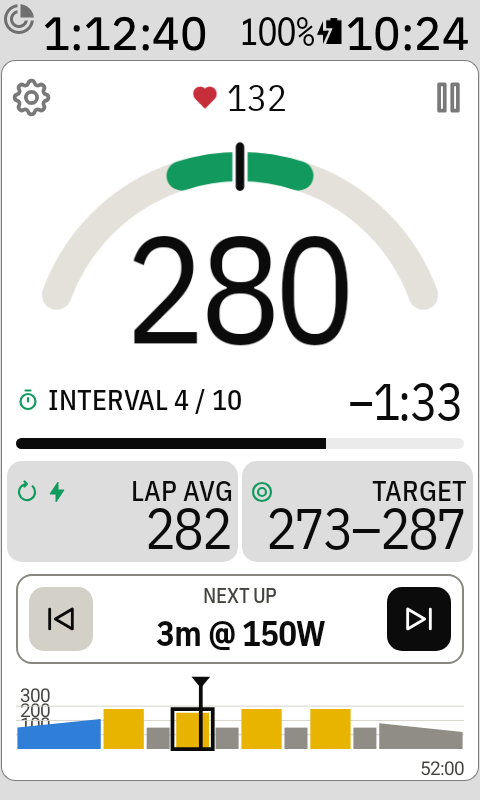
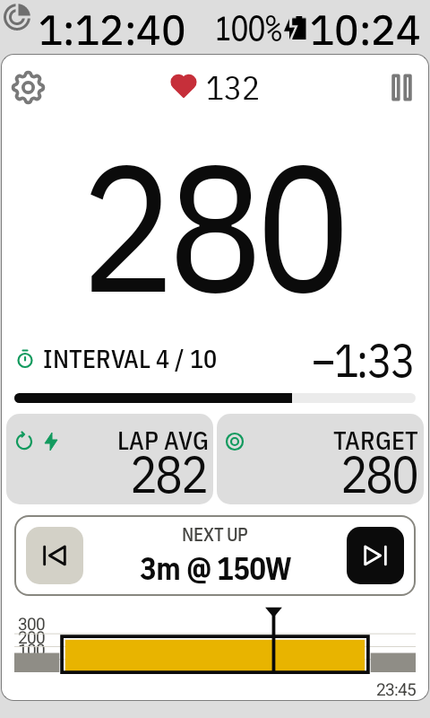
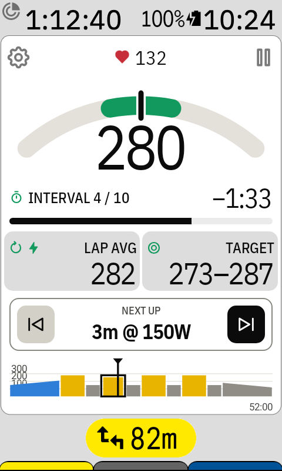

# The workout screen

## Before you start

A workout you've picked waits until you start it, so you can load it before the ride and ride
for a while first (warm up on your own, get out of town).

- Your watts and heart rate (or cadence) are live; the workout's clock doesn't run.
- **START WORKOUT** starts the usual 5-second countdown. The button counts down too: tap it
  again (**TAP TO CANCEL**) to stop. A tap on the purple countdown below starts right away. A
  short rising tune plays when the workout starts. The remote's **Pause or resume workout** button
  works like START: it starts the countdown, or cancels it. ⏭ / ⏮ also cancel it.

- **First up** shows the interval it will start with. ⏭ / ⏮ choose another one, for example to
  skip the warm-up: the label then says **Start at 3 / 16** and the chart outlines that interval.
- When the ride ends (or no ride is on), the workout goes back to waiting at the first interval.

## Once it runs

From top to bottom:

| Part | What it shows |
| --- | --- |
| ⚙ (top left) | Opens the [Workouts page](workouts-and-account.md) |
| ❤ number | Heart rate |
| ⏸ (top right) | [Pauses the workout](pausing.md) |
| Big number | Power (3 s by default, see [Settings](settings.md)). Tap it to [change the colours](watts-colours.md) |
| Interval 1 / 16 | Which interval you're in, out of how many |
| Time | Time left in this interval, counting down (−2:18) |
| Bar | How much of the interval is done |
| Left tile | Lap avg or [Lap NP](tiles.md) for this interval |
| Right tile | Target or [Target range](tiles.md) for this interval |
| Next up | The next interval's length and watts, with ⏮ / ⏭ to [jump](jumping.md) |
| Chart | The whole workout |

## The chart

Each bar is one interval, in its power zone colour: the Karoo's seven power zones (Z1 grey,
Z2 blue, Z3 green, Z4 yellow, Z5 orange, Z6 red, Z7 purple), as % of the workout's FTP. Finished
intervals keep their colour, so you can still see what you'd jump back to. The current interval
is outlined, and a black marker (white in dark mode) shows where you are. The end time of the workout is on the right.

Tap the chart to zoom in on the current interval. Tap again to see the whole workout.

## Laps and beeps

- Every interval is its own lap in your ride file, so intervals.icu and Strava show them
  separately.
- Short beeps play in the last 3 seconds of each interval.

## With a route

When you follow a route the Karoo shows the route under the field and makes it shorter. The
watts shrink to fit; everything else stays the same.

