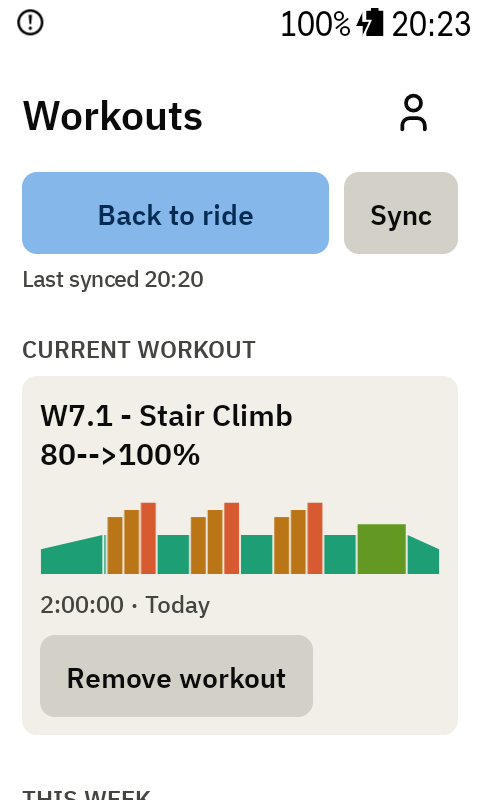
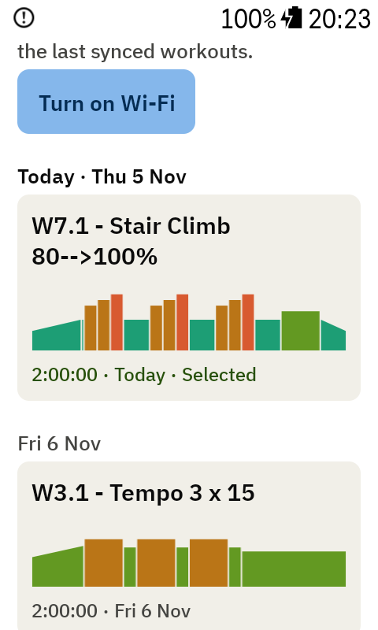
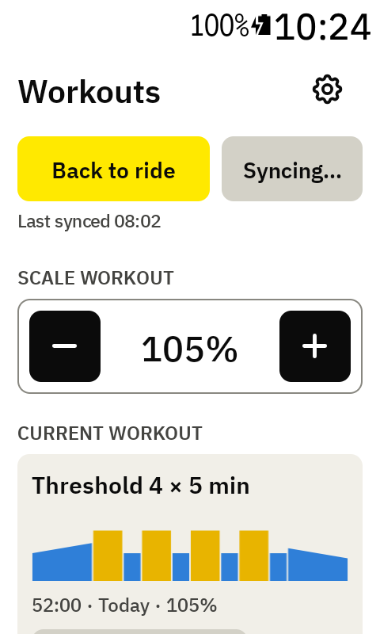
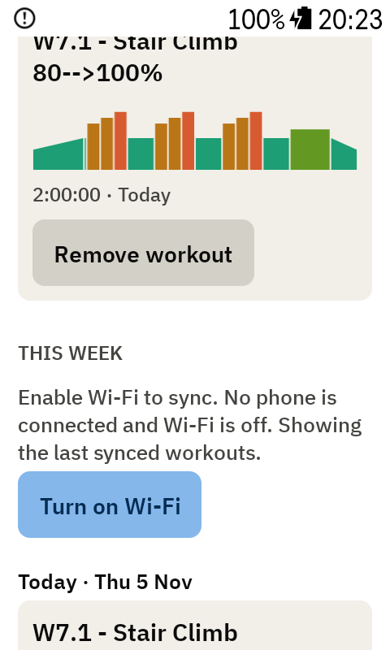
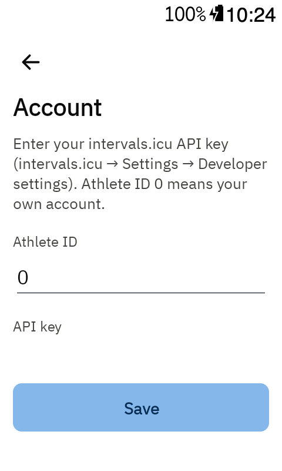

# Workouts and Account

Open the **Workouts** page with ⚙ on the ride screen, or open **DDB BetterIntervals** from the Karoo's
app list. ⚙ on the Workouts page opens [Settings](settings.md).

## Workouts

 

- **Sync** loads this week's planned workouts from intervals.icu. When it last synced shows right
  under the button (or **Offline** in amber when there's Wi-Fi but no internet).
- Today's workouts come first, then the coming days, then the days already past this week.
- Each card shows the workout's name, its shape in zone colours, its length and its day.
- Tap a card (the › in its corner) for its [details](#workout-details); **Select workout** there picks it and takes you
  back to the ride screen.
- **Remove workout** takes the current workout off, so the ride screen shows the
  [free-ride screen](free-ride.md).
- **Back to ride** (yellow) returns to the ride.

The app never picks a workout by itself.

### Workout details

A workout's page: its picture in your zone colours with your FTP as a dashed line, then its
numbers (time, TSS, IF, average power, NP and estimated calories), the notes from intervals.icu,
the time in each power zone, and every interval with its watts, % of FTP and zone (repeats grouped).
**Select workout** (top right) picks it.

Every workout's picture is drawn on the same scale, so you can compare them: the top is 130 % of
your FTP and the FTP line always shows. Only a workout with higher steps (sprints) gets a taller
scale, just enough for its highest step. Tap a block in the picture to see that interval: its name,
time, watts, % of FTP and zone. Tap it again, or anywhere else, to close it.

### Changed on intervals.icu

If you change the workout you're riding on intervals.icu and open the Workouts page mid-ride, an
orange card asks: **Keep current workout** or **Use new targets**. Neither restarts the workout; it
carries on where it is. Tick **Restart workout with new targets** to start the new version over.

### Scale workout

While a workout is loaded, **Scale workout** sits above it: − and + make every power target 1%
easier or harder (100% is the workout as planned). The card shows the scale and its shape grows
or shrinks with it, and the ride screen uses the scaled watts at once: where you are in the
workout doesn't change. The outlined card above the − and + shows the watts before → after: before
the start the first interval's ("First up · Warm-up 20:00", a ramp as its range, e.g. 120–179 → 121–181 W),
while you ride the current interval's. Heart-rate targets aren't scaled. Picking another workout starts it at
100%.

## Offline

Syncing goes through the Karoo, over Wi-Fi or your phone. Without either, the page says **Enable
Wi-Fi to sync** with a **Turn on Wi-Fi** button. It syncs by itself as soon as Wi-Fi connects. The
last synced week stays available offline.

## Account

On the Workouts page, tap ⚙, then **intervals.icu account**. The row says **Connected** once a
key is saved.

- **API key**: from intervals.icu under **Settings → Developer settings**. It's hidden as you
  type and stored only on the Karoo.
- **Athlete ID**: leave it at `0` for your own account.

